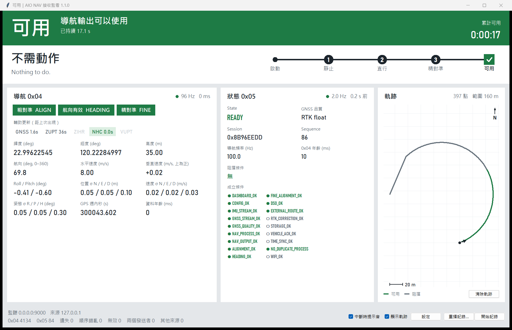

# AIO NAV 接收監看 (AIO NAV Receiver)

Receives the AIO NAV **0x04** navigation packets and the dashboard **0x05** status packets over UDP.
It shows whether the navigation output may be used right now, using the same rules as web_monitor
`nav/vehicle_gate.py`, together with the operator instruction from 0x05. It runs on Windows, Linux
and macOS laptops.



## Run

| System | File | Start |
|---|---|---|
| Windows 10/11 | `AIO_NAV_Receiver.exe` | double-click |
| Linux (x64, glibc ≥ 2.35) | `aio-nav-receiver` | `./aio-nav-receiver` |
| macOS (Apple silicon) | `AIO NAV Receiver.app` | first time: right-click → Open (the app is not signed) |

No Python is needed on the target. The files come from the GitHub Actions build (see *Release*), or
from `python scripts/build.py` on that system.

**Firewall, first time on a PC.** The app's **複製防火牆指令** button copies the command for this system.

```
New-NetFirewallRule -DisplayName "AIO NAV UDP" -Direction Inbound -Protocol UDP -LocalPort 9000 -Action Allow
```

That is the Windows command; run it in an admin PowerShell. On Linux with ufw, run `sudo ufw allow 9000/udp`.
On macOS, allow "incoming connections" and "Local Network" the first time the app asks.

**On the Jetson.** Set Maintenance → AIO NAV config → `output_udp` to this PC's IP:9000, then restart AIO NAV.
For 0x05, set `status_udp.enabled: true` in the dashboard config (it is off by default). Without 0x05
the app always shows 阻擋 "沒有最新的狀態封包", by design.

## Screen

The colours follow road signs and only ever carry meaning:

| Band | Meaning |
|---|---|
| **Green 可用** | the navigation output may be used |
| **Yellow 阻擋** | not yet, as expected: alignment in progress or READY still settling; follow the instruction |
| **Red 阻擋** | something is wrong: data lost, fault, stale, flags, a port that could not be bound, an internal error, or a screen that has not updated for 0.5 s |
| **Grey 阻擋** | nothing to judge yet (no packets), or AIO NAV stopped on purpose |

| Area | Shows |
|---|---|
| Band | the verdict, one plain reason, how long it has been in that state, total usable time |
| Instruction and route | what the operator must do now (`requested_action` from 0x05) and the alignment route 啟動 → ① 靜止 → ② 直行 → ③ 精對準 → 可用, with the 2 s READY count filling the last sign. Before any packet arrives, it shows the setup steps with this PC's IP address instead |
| 導航 0x04 | stream light (rate and age, or how long it has been gone), ALIGN / HEADING / FINE lamps, aiding flags with time since last seen, position, velocity, attitude, σ |
| 狀態 0x05 | stream light, state, GNSS quality, session, sequence, blocking conditions (red), all 18 health conditions (● met, ○ not met). Values turn grey when 0x05 is out of date |
| 軌跡 | last 5 minutes on graph paper, green where usable and grey where blocked; heading arrow, scale bar, north up |
| Footer | source and sender IP, packet counters (problems highlighted), ● 記錄中 with elapsed time, **中斷時提示音**, **顯示軌跡**, **設定**, **重播記錄…**, **開始記錄** |

When the output stops being usable, the band blinks red and the PC beeps (turn off with
**中斷時提示音**). The verdict is also in the window title, so the taskbar shows it. While replaying, a
dark bar across the top says it is not live data and holds the speed and **回到即時** controls.

Keys: **Ctrl+R** start / stop recording, **Ctrl+O** open a recording, **F11** full screen, **Esc** leave
full screen. The window sizes itself to the screen and scales text down on small or highly scaled
laptop screens.

## Recording and replay

**開始記錄** writes to `logs/` next to the executable, so a USB stick keeps its recordings. If that
folder isn't writable, or the app is a macOS `.app`, it writes to `Documents/AIO NAV Receiver/logs`
instead. You can choose another folder in **設定**.

| File | Content |
|---|---|
| `aio_<time>.bin` | every packet with its receive time and sender (format v2, see [docs/DESIGN.md](docs/DESIGN.md)) |
| `aio_<time>_nav.csv` | decoded 0x04 (can be turned off; rebuild later with `export`) |
| `aio_<time>_events.log` | each 可用 / 阻擋 change, with the time of day |

Files are written by a separate thread, so a slow USB stick can never delay receiving or cause a
false 阻擋. A write error, such as a full disk or a pulled USB stick, stops the recording and shows
the error. So does storage falling about 5 minutes behind. Monitoring carries on. The footer shows
the full path of the recording in progress.

**重播記錄…** plays a `.bin` at 1×, 2×, 5× or 10×. The verdicts are worked out from the recorded
times, so a replay shows the same 可用 / 阻擋 changes at the same moments as the original run, at
any speed. There is one exception: a replay starts with no history. If recording started while the
output was already 可用, the replay shows 阻擋 (READY 尚未穩定) for its first ~2 s.

Recordings made before 1.0 still open. They carry no sender address, so the 只接受來源 IP filter
doesn't apply to them.

## Command line

```
aio-receiver                                  # the window, listening
aio-receiver --replay logs/aio_….bin --speed 5
aio-receiver check logs/aio_….bin [--json]    # print every 可用 / 阻擋 change, no window
aio-receiver export logs/aio_….bin [-o x.csv] # decoded 0x04 as CSV
```

From the portable build, use the executable's name instead of `aio-receiver`. The app writes its
own diagnostic log to `%LOCALAPPDATA%\AIO NAV Receiver\app.log` on Windows,
`~/Library/Logs/AIO NAV Receiver/` on macOS and `~/.local/state/aio-nav-receiver/` on Linux.

Settings are saved to `~/.aio_receiver.json`. A bad value falls back to its default, and the app
lists what it ignored.

## Develop

```
python -m venv .venv
.venv\Scripts\activate            # Linux / macOS: source .venv/bin/activate
pip install -e ".[dev]"

python tools/fake_sender.py       # 100 Hz 0x04 + 2 Hz 0x05 cycling through the alignment states
python -m aio_receiver            # run from source
pytest                            # unit, regression on real recordings, engine, UI smoke
ruff check src tests tools
mypy
python scripts/build.py           # all checks, then the executable for this system
```

Layout:

| Path | |
|---|---|
| `src/aio_receiver/core/` | packet formats, gate rules, time-ordered evaluation; pure, no I/O |
| `src/aio_receiver/io/` | `.bin` reader and writer, UDP and replay sources |
| `src/aio_receiver/engine.py` | the worker thread; publishes snapshots to the window |
| `src/aio_receiver/ui/` | tkinter window |
| `fixtures/` | shared by the desktop and iOS tests: windows of a real 30-minute Jetson session (positions moved to 0°, 0°) with the verdicts the pre-1.0 gate gave, and `gate_vectors.json` (below) |
| `tools/` | test sender, fixture cutter, parity check against web_monitor's `VehicleGate`, `make_gate_vectors.py` |
| `ios/` | the iPhone app (SwiftUI), see [ios/README.md](ios/README.md) |
| `docs/DESIGN.md` | architecture, time model, failure modes, trade-offs |

## iPhone app

`ios/` holds the same receiver for iPhone (iOS 26): live 可用 / 阻擋 with the operator instruction,
charts of the last 1–10 minutes, the track on a map, in 繁體中文 and English. It uses the same rules
as the desktop gate, and both are tested against the same files:

- `fixtures/gate_vectors.json`: a scripted stream (lost, reordered and second-sender 0x05, bad
  checksums, NaN, time going back, …) with this gate's verdict and counters at every step. Written by
  `python tools/make_gate_vectors.py`; `tests/test_shared_vectors.py` checks the desktop still
  produces it, and the iOS tests replay it through `VehicleGate.swift`.
- `fixtures/real_*.bin.gz`: the iOS tests replay the real recordings with the same deadline timing as
  `analysis.analyse` and must give every transition in the `.expected.json` files.

After changing a rule here, regenerate the vectors and make `ios/MyApp/Protocol/VehicleGate.swift`
follow; the `ios` workflow runs the iOS tests when `ios/`, `fixtures/` or the generator change.

## Release

Push a tag such as `v1.0.0`. GitHub Actions then:

1. runs lint, type checks and tests on Windows, Linux and macOS;
2. builds the three executables;
3. attaches them to a GitHub Release.

Any push or pull request runs steps 1 and 2. The executables are then available as downloadable
artifacts of that run.
